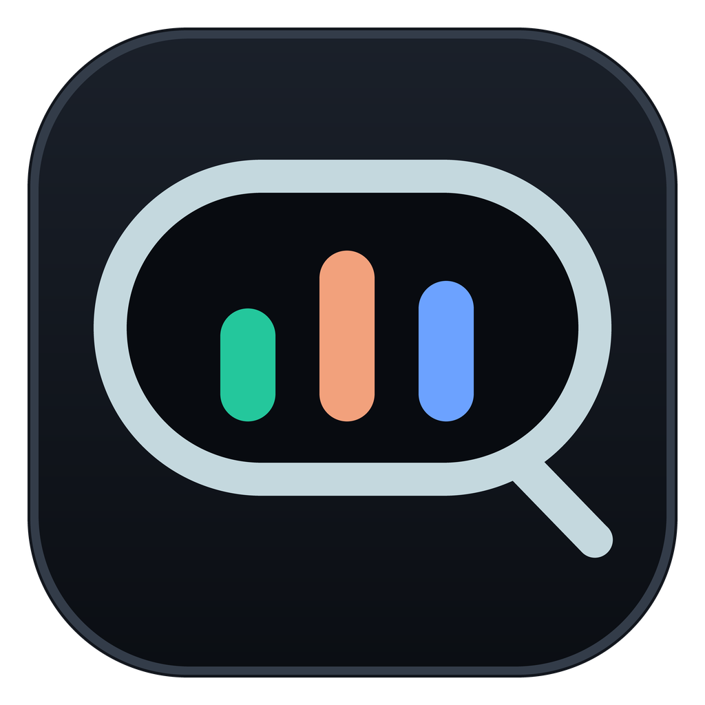
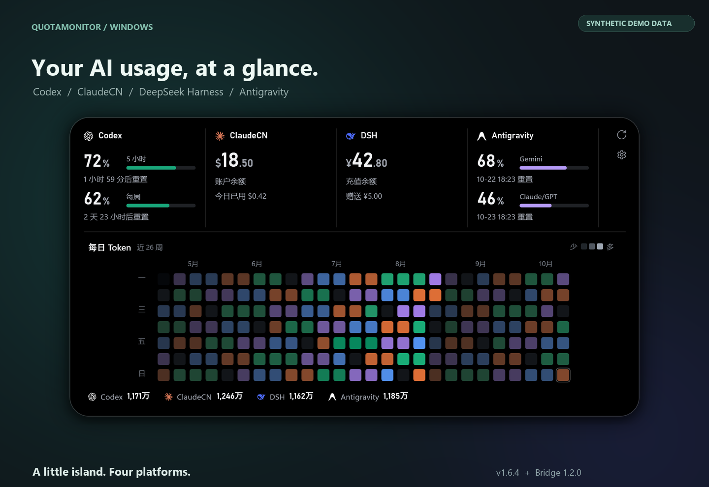
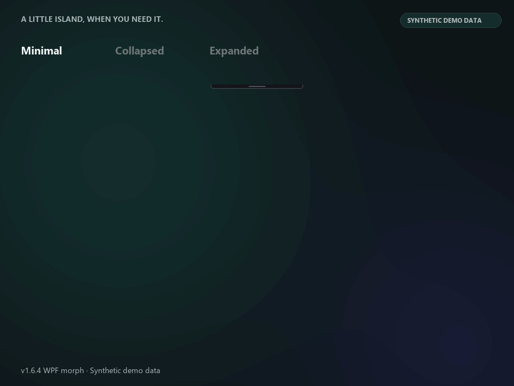
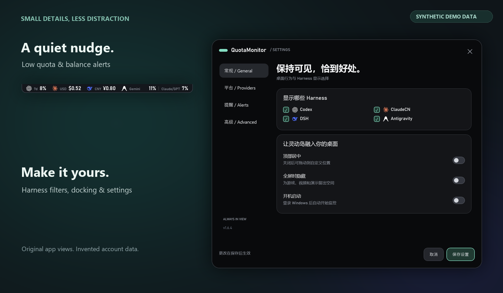

<strong>English</strong> | <a href="README.zh-CN.md">简体中文</a>

<h1 align="center">QuotaMonitor</h1>

An AI usage Dynamic Island on your Windows desktop.

<a href="https://github.com/asdstrind/QuotaMonitor/releases/latest"><strong>Download for Windows ↗</strong></a> Windows 11 x64 · Bundled runtime, just unzip and run.

Codex quota · ClaudeCN & DeepSeek Harness balance and usage · Antigravity weekly quotas Usage history heatmaps · Harness filters · Low-balance alerts · Smooth animations

v1.6.4 · Synthetic demo data

Pure vibe coding. The code doesn't generalize well and is only for my personal use. I won't update or maintain it. Want more features, a different platform, or a new look? Hand the code to your own AI Agent and tinker with it however you like.

---

[Setup](docs/CONFIGURATION.md) · [Build](BUILDING.md) · [Bridge](bridge/dsh-balance-bridge/README.md) · [Privacy](SECURITY.md) · [MIT](LICENSE) · [Third-party marks](TRADEMARKS.md)
