<p align="center"><strong>English</strong> | <a href="README.zh-CN.md">简体中文</a></p>

<p align="center">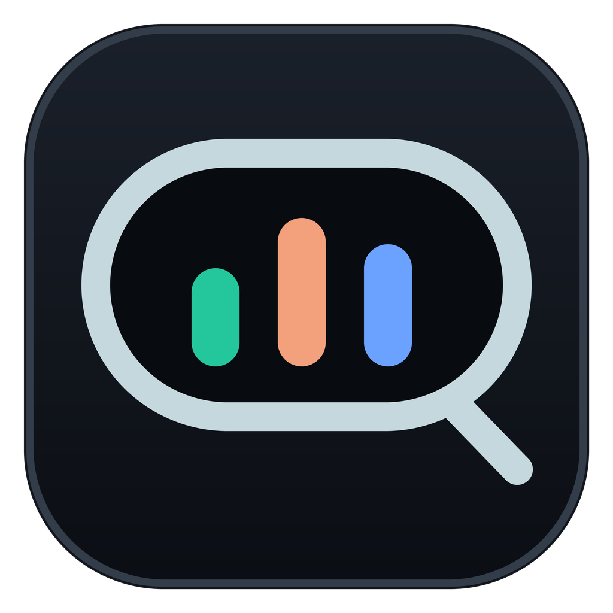</p>
<h1 align="center">QuotaMonitor</h1>
<p align="center"><strong>A lightweight Windows dynamic island for monitoring AI coding quotas and token usage.</strong></p>
<p align="center">Codex · DSH (DeepSeek Harness) · Antigravity · OpenCode Go</p>

<p align="center">
  <a href="https://github.com/asdstrind/QuotaMonitor/releases/latest"><strong>Download v1.7.0 for Windows 11 x64</strong></a><br>
  <sub><code>QuotaMonitor-v1.7.0-win-x64.zip</code> · self-contained, no installer, no admin rights</sub>
</p>

<p align="center">
  
  
  
</p>

<p align="center"><a href="docs/media/v1.7.0/hero.png">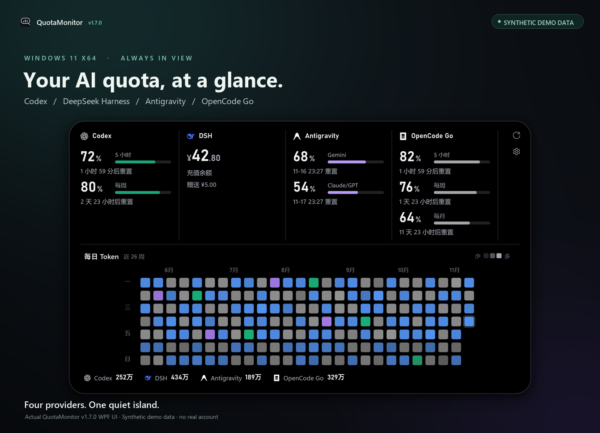</a></p>
<p align="center"><sub>Actual QuotaMonitor v1.7.0 UI. Synthetic demo data; no real account is shown.</sub></p>

<p align="center"><code>Quota windows &amp; reset times</code> · <code>26-week token heatmap</code> · <code>Local-first history</code> · <code>Low-quota alerts</code> · <code>Always-on-top island</code></p>

QuotaMonitor sits quietly at the top edge of your Windows desktop and turns the important numbers of your AI coding tools into one compact island: remaining quotas, reset countdowns, balances, and a token-usage calendar built from data that already exists on your machine.

It works with the tools you already sign in to — Codex CLI, DSH (DeepSeek Harness), and the Antigravity client — and adds OpenCode Go through a read-only Console API key. There is no account to create, no telemetry, and no cloud relay.

**Contents:** [Preview](#preview) · [Features](#features) · [Supported providers](#supported-providers) · [Quota monitoring](#quota-monitoring) · [Token usage analytics](#token-usage-analytics) · [The dynamic island](#the-dynamic-island) · [Installation](#installation) · [Configuration](#configuration) · [Security &amp; privacy](#security--privacy) · [Technical architecture](#technical-architecture) · [Build from source](#build-from-source) · [Known limitations](#known-limitations) · [License &amp; credits](#license--credits) · [FAQ](#faq)

## Preview

<p align="center">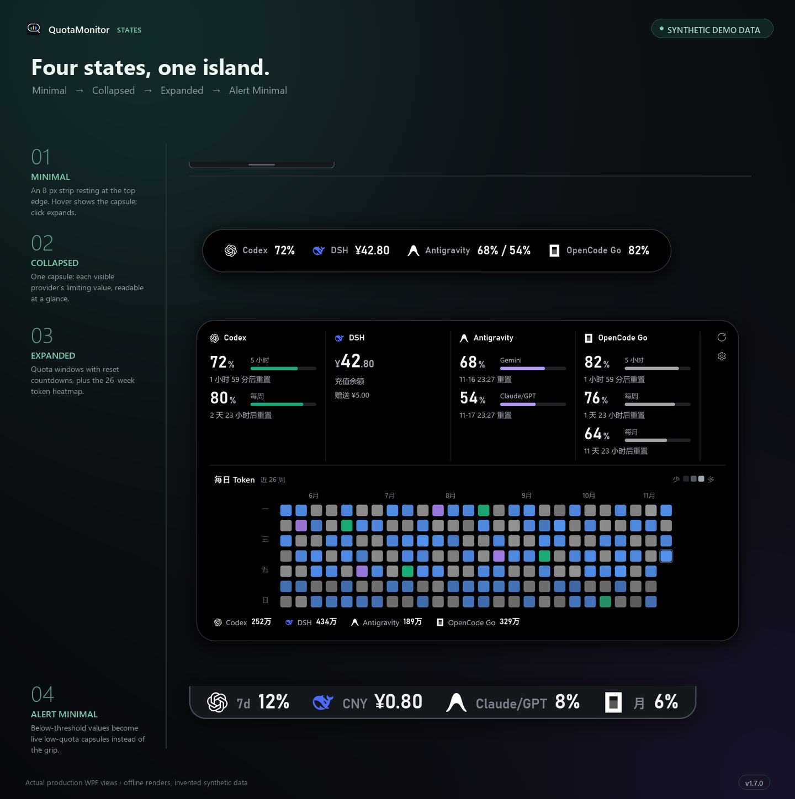</p>
<p align="center"><sub>Minimal → Collapsed → Expanded → Alert Minimal. Actual v1.7.0 UI, synthetic demo data.</sub></p>

Production captures of the island states, quota view and token heatmap — all with synthetic demo data.

## Features

- **Four providers, one island.** Codex, DSH, Antigravity and OpenCode Go live side by side — or any subset you choose in Settings.
- **Server quota, not a guess.** Remaining percentages and reset times come from each service's own response, with per-window detail in the expanded view.
- **Local-first token history.** A 26-week calendar heatmap, per-day tooltips and per-provider totals from data recorded on your machine or exported by the provider.
- **A real desktop citizen.** Always on top, never in the taskbar, hides in fullscreen apps, and stays reachable from the notification area.
- **Low-quota alerts that stay quiet.** Independent thresholds per provider and window; the minimal strip expands into a small alert capsule only when fresh data is genuinely low.
- **Tooltips after the morph.** Date tooltips wait until the island's morph settles before appearing, so a date card never flashes clipped while the island expands.
- **Honest about missing data.** Stale, partial or unavailable readings are shown as such and never invented as `0%`.
- **Native and small.** WPF on .NET 10, a single self-contained folder, no Electron, no telemetry, no update service.

## Supported providers

| Provider | What you see | Where the numbers come from | Setup |
| --- | --- | --- | --- |
| **Codex** | Server rate-limit windows (5-hour + weekly) with reset countdowns | Codex app-server `account/rateLimits/read`, using your existing CLI login | Install and sign in to Codex CLI; `codex.exe` is auto-discovered, or set a path |
| **DSH** (DeepSeek Harness) | Official DeepSeek wallet balance (recharge + bonus, original currency) and DeepSeek-routed token usage | Balance via [DSH Balance Bridge](bridge/dsh-balance-bridge/README.md) inside the official DSH host; usage from local DSH sessions | Install compatible DSH Desktop, sign in, add Balance Bridge 1.3.0 |
| **Antigravity** | Two *weekly* quota pools: Gemini and Claude/GPT, with reset times | Antigravity's local Language Server, while the official client is signed in and running | Open and sign in to the official Antigravity client |
| **OpenCode Go** | Rolling 5-hour, weekly and monthly quota windows; token export history | OpenCode quota API and Console usage export (`provider=opencode-go`, 90 days) | Save an OpenCode Console **read-only** API key in Settings |

> **DSH DeepSeek balance and the OpenCode Go subscription are independent billing sources.** QuotaMonitor displays them separately and never merges, converts or infers one from the other. Antigravity's Claude/GPT pool is Antigravity's own weekly quota — it is not a Claude subscription or Anthropic billing.

> **v1.7.0 monitors four providers.** The former ClaudeCN integration has been removed. Antigravity's Gemini and Claude/GPT weekly pools remain fully supported.

<p align="center">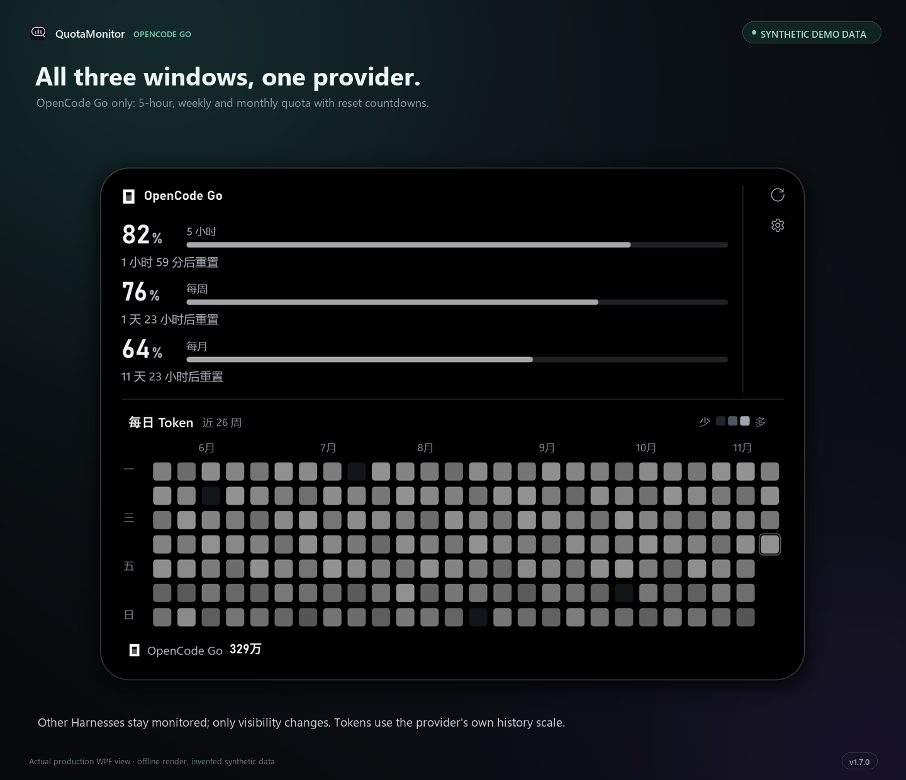</p>
<p align="center"><sub>OpenCode Go on its own: all three server windows and their reset times. Synthetic demo data.</sub></p>

## Quota monitoring

The expanded island shows one compact instrument per visible provider: quota gauges with remaining percentage, reset countdown and a progress bar, or a wallet balance with its extra bonus wallets.

- **Codex** publishes its own quota windows. Window durations and reset times come from the server response; not every account exposes both a 5-hour and a weekly window, and the island reflects what is actually returned. While collapsed, a verifiably exhausted window in the selected pool is shown as `0%`.
- **DSH** shows the official account snapshot delivered by the Balance Bridge: recharge and bonus wallets in their original currencies, kept separate and never sum-converted. The bridge re-queries every three minutes inside the official host; values older than four minutes are marked stale.
- **Antigravity** exposes two independent weekly pools (Gemini, Claude/GPT). It is *not* a two-week cycle; when the local client cannot be read, the pool is shown as unavailable or stale rather than guessed.
- **OpenCode Go** returns three server windows: rolling 5-hour, weekly and monthly. Remaining percentage is `100 − used`. The collapsed capsule shows the single most constrained window using the official allowance proportions (5h = 20%, week = 50%, month = 100% of the monthly base) and displays that window's own percentage.

Failures keep the last good reading and mark it **stale**; providers that were never readable show **unavailable** or a setup hint. Nothing is fabricated as a zero.

<p align="center">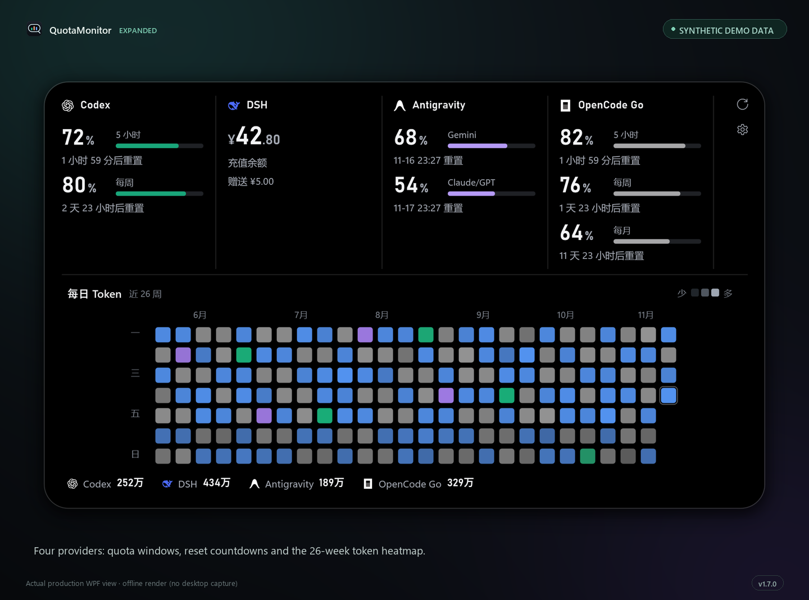</p>
<p align="center"><sub>Expanded view: one instrument per provider, with windows, balances and reset times. Synthetic demo data.</sub></p>

<p align="center">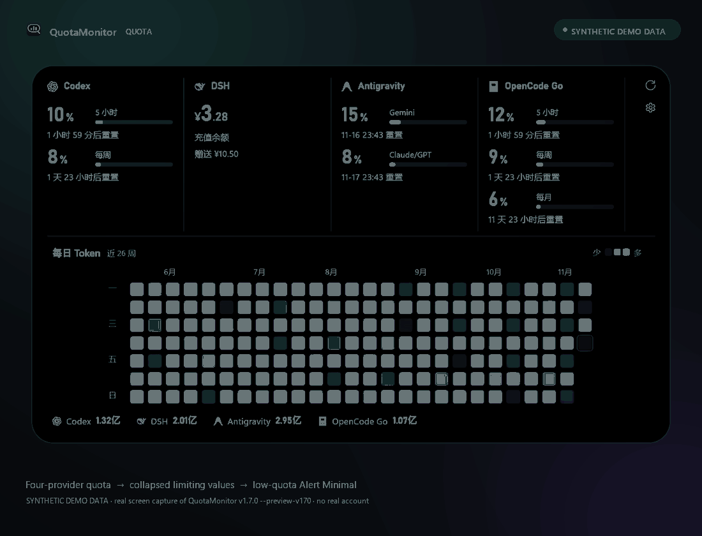</p>
<p align="center"><sub>Quota instruments, the collapsed limiting value and low-quota alert behaviour. Synthetic demo data.</sub></p>

## Token usage analytics

Token history is deliberately separate from quota. It is assembled from local read-only records for Codex, DSH and Antigravity, plus the provider's own export for OpenCode Go, and is never used to reverse-engineer a quota:

- **Codex** — local rollout files under `sessions` and `archived_sessions`. Only numeric usage fields are parsed; conversation text is discarded. Duplicate mirrors are de-duplicated by response ID.
- **DSH** — locally recorded DeepSeek-routed sessions. Only recorded requests are counted; unrecorded helper calls are not invented, and the totals are not an account lifetime figure. The optional cost estimate uses a dated price snapshot and is always marked *Estimated* — it is not a bill.
- **Antigravity** — a separate read-only local history channel (SQLite, with an optional Tokscale session cache). It never reads chat content and never derives tokens from weekly quota changes.
- **OpenCode Go** — the Console's 90-day CSV export, filtered to `provider=opencode-go`. Tokens are `input + output + cache read + 5m cache write + 1h cache write`; `output` already includes reasoning. Days keep the server's UTC dates, so they are labelled UTC, and the export is not lifetime history.

The heatmap covers the last 26 weeks, Monday-first, one rounded tile per day. Brightness follows a shared log scale (winsorized at the 95th percentile of daily totals) and colour follows the day's dominant provider. Hover a tile for the per-provider breakdown and total; hover a provider in the legend to focus that provider's lane. The legend totals are the verifiable history currently saved for each source — **not** an account lifetime total — and unknown values stay `—`.

Daily aggregates are stored locally for Codex, DSH and Antigravity. OpenCode Go history stays in memory and is fetched again after a restart. The design and count boundaries are documented in [OPENCODE-GO-TOKENS.md](docs/OPENCODE-GO-TOKENS.md) and [ANTIGRAVITY-HISTORY.md](docs/ANTIGRAVITY-HISTORY.md).

<p align="center">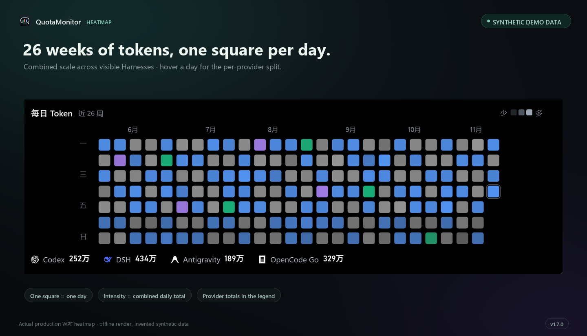</p>
<p align="center"><sub>26-week token calendar with provider legend totals. Synthetic demo data.</sub></p>

<p align="center">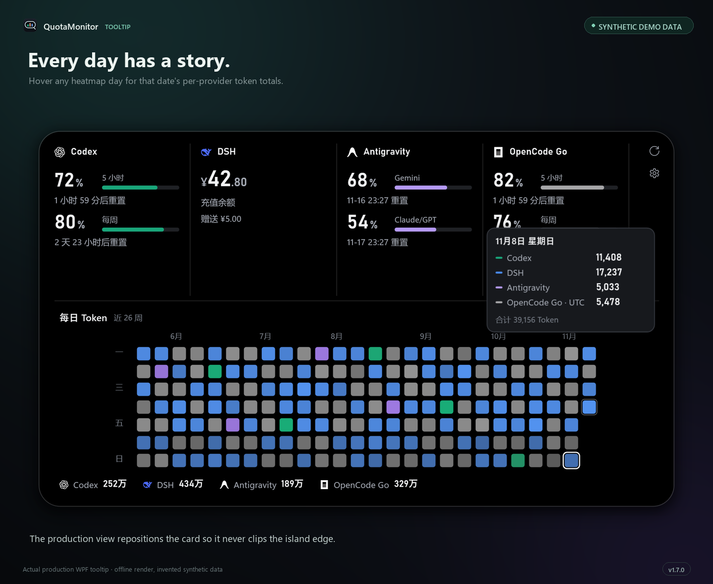</p>
<p align="center"><sub>Daily tooltip: per-provider values, total, and UTC labels for OpenCode Go. Synthetic demo data.</sub></p>

<p align="center">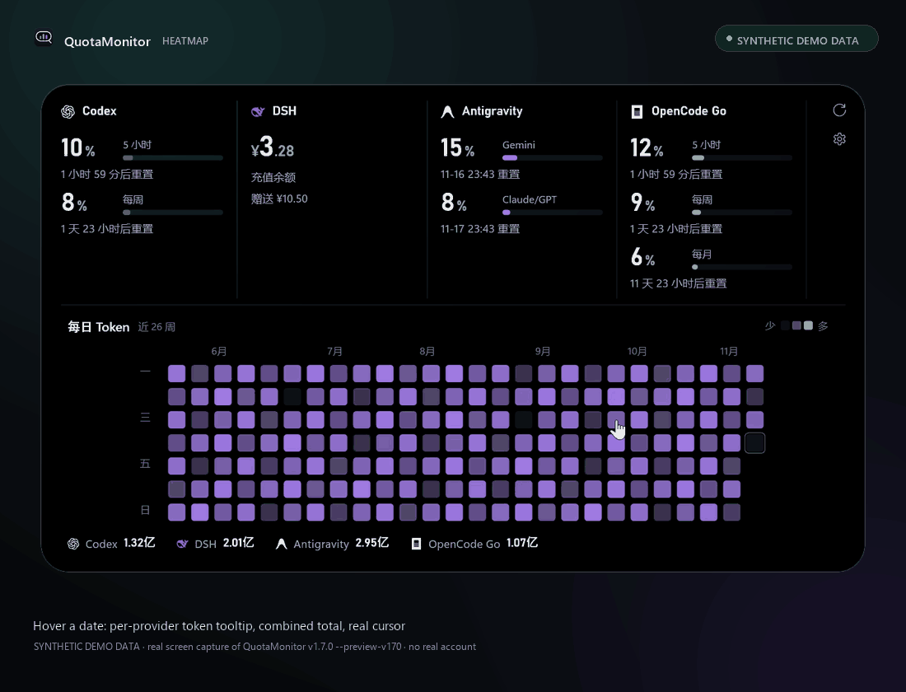</p>
<p align="center"><sub>Hover, tooltip and provider focus on the heatmap. Synthetic demo data.</sub></p>

## The dynamic island

The island has four states and is driven by the pointer, not by constant windows:

| State | What it shows |
| --- | --- |
| **Minimal** | A slim strip at the top edge of the screen. A quiet grip, not a status indicator — hover it to reveal the capsule. |
| **Collapsed** | One capsule with each visible provider's headline value: Codex percentage, DSH wallet balance, Antigravity Gemini / Claude-GPT percentages, OpenCode Go's limiting window. |
| **Expanded** | The full dashboard: quota instruments with reset countdowns and the token heatmap. No scrolling. |
| **Alert Minimal** | When a threshold is crossed with fresh data, the minimal strip becomes a small capsule with one icon-and-value slot per affected provider. |

- **Hover** near the strip to show **Collapsed**; **click** the capsule to open **Expanded**; move away and the island returns to **Minimal** (about 0.7–0.9 s); **Esc** returns immediately.
- **Drag** the collapsed capsule, or the expanded instrument strip, to move the island. With **top-center** enabled (the default) the island is locked to the top center and dragging is ignored until you turn it off. Free positions are saved across restarts, and switching top-center off and on again keeps your saved position.
- **Settings** opens from the gear icon in Expanded, from the tray menu, or from the gear button shown when no provider is selected.
- **Tray** right-click offers Refresh, Settings and Exit. Closing the island hides it to the notification area; use tray → Exit to quit before upgrading. Double-clicking the tray icon brings the capsule back.
- **Fullscreen** apps hide the island automatically (enabled by default), and the layout scales to the available work area instead of adding scrollbars.

<p align="center">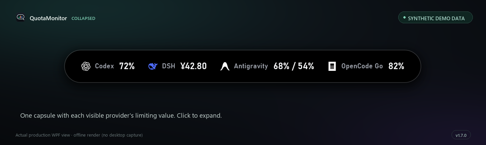</p>
<p align="center"><sub>Collapsed capsule. Synthetic demo data.</sub></p>

<p align="center">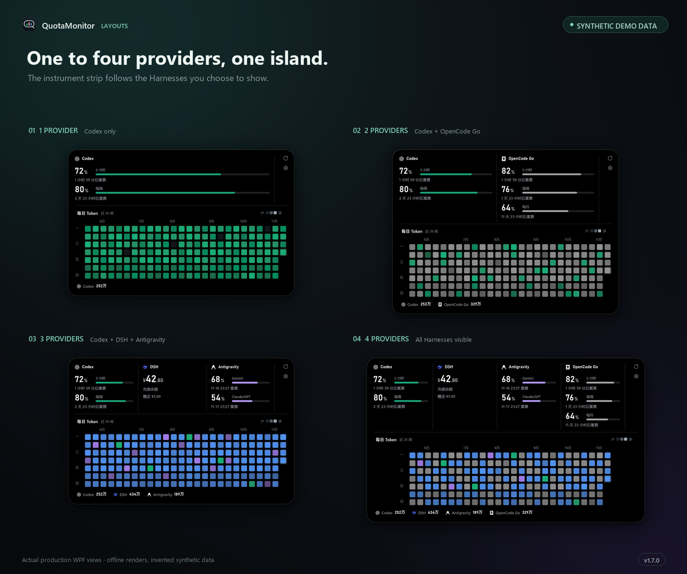</p>
<p align="center"><sub>One to four visible providers — the layout adapts. Synthetic demo data.</sub></p>

<p align="center">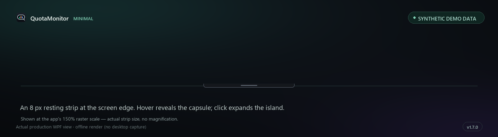</p>
<p align="center"><sub>Minimal strip. Synthetic demo data.</sub></p>

<p align="center">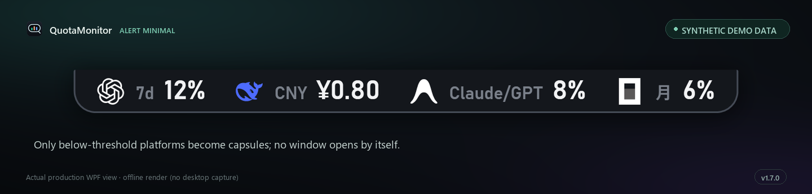</p>
<p align="center"><sub>Alert Minimal: one icon-and-value slot per affected provider, shown only for fresh data below a threshold. Synthetic demo data.</sub></p>

## Installation

QuotaMonitor ships as a self-contained Windows x64 ZIP. The .NET runtime is bundled; nothing needs to be installed first, and no administrator rights are required.

1. Download `QuotaMonitor-v1.7.0-win-x64.zip` from [Releases](https://github.com/asdstrind/QuotaMonitor/releases/latest).
2. Unzip the **whole folder** and keep its files together. Do not run the executable from inside the archive.
3. Run `QuotaMonitor.exe`. The island appears at the top center of your primary display.
4. Open Settings (gear icon in Expanded, or tray → Settings) and connect the providers you use. Providers without data show a setup hint instead of invented numbers.

**Windows SmartScreen:** the executable is not code-signed, so the first launch may show "Windows protected your PC". Choose **More info → Run anyway**. Release assets include `QuotaMonitor-v1.7.0-win-x64.zip` and `QuotaMonitor-v1.7.0-win-x64.zip.sha256`; verify the hash before running.

**Upgrading:** right-click the tray icon and choose **Exit** before replacing the folder. Keeping the previous folder as a backup is fine — settings live outside it. **Uninstalling:** exit from the tray, turn off start-with-Windows in Settings, delete the folder, remove the `QuotaMonitor/OpenCodeGo/ConsoleReadOnlyApiKey` credential from Windows Credential Manager, and delete `%LOCALAPPDATA%\QuotaMonitor` if you want to remove local history.

**Requirements:** Windows 11 x64. The app uses the system default network configuration.

## Configuration

Settings has four pages. Open it from the gear icon in Expanded or from the tray menu; **Esc** closes it and **Ctrl+S** saves.

| Page | What you configure |
| --- | --- |
| **General / 常规** | Which providers are visible; top-center positioning; hide in fullscreen; start with Windows |
| **Providers / 平台** | Per-provider enable switches; OpenCode Go read-only API key (with Test connection and Remove stored token); DSH and Antigravity connection notes |
| **Alerts / 提醒** | Low-quota thresholds for each provider and window; `0` disables that alert; DSH alert currency (CNY / USD) |
| **Advanced / 高级** | Per-provider refresh interval in seconds; path overrides for `codex.exe` and the DSH sessions directory; DSH estimated-cost toggle and optional model/price override |

- **Refresh** runs independently per provider: Codex 180 s, DSH 90 s, Antigravity 60 s, OpenCode Go 180 s by default. Intervals are configurable from 30–3600 s (OpenCode Go: 180–3600 s). Manual refreshes never bypass OpenCode Go's quota/export cooldowns or a `Retry-After` response.
- **Codex executable** is auto-discovered from `PATH`; set a path only if you use a custom installation. **DSH sessions directory** defaults to your `~/.dsh/sessions`; leave the override empty to keep auto-discovery.
- **OpenCode Go** needs a Console **read-only** API key. The key is stored in Windows Credential Manager as `QuotaMonitor/OpenCodeGo/ConsoleReadOnlyApiKey` only when you save; leaving the field empty keeps the stored key. Test connection validates both the quota API and the token export.
- **Start with Windows** writes a single per-user Run value for QuotaMonitor, verifies the real executable path when you save, and repairs a stale path after the folder is moved. It respects a disabled startup entry (for example from Task Manager) and reports failures in Settings instead of pretending success.
- **DSH estimated cost** can be turned off. When on, it uses a dated official price snapshot; unmatched models or unknown cache-write prices stay unknown, and the result is never labelled as a bill.

<p align="center">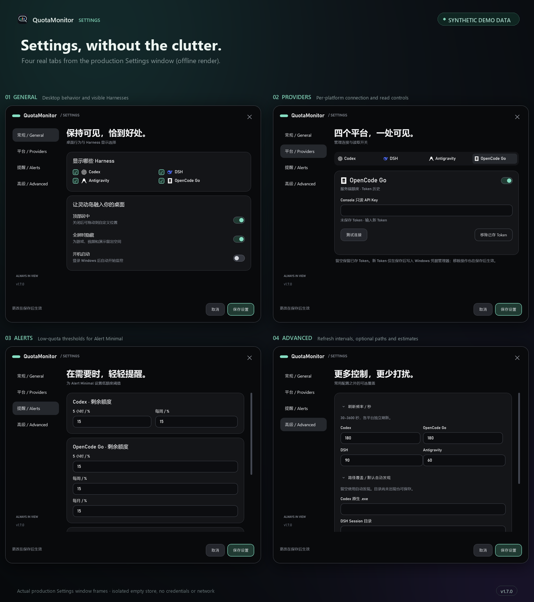</p>
<p align="center"><sub>Settings pages as rendered in v1.7.0 (English labels are presentation labels).</sub></p>

## Security &amp; privacy

- **One credential.** The only secret QuotaMonitor stores is your OpenCode Go read-only API key, in Windows Credential Manager as `QuotaMonitor/OpenCodeGo/ConsoleReadOnlyApiKey`. No credentials are bundled with the app.
- **No accounts, no telemetry.** There is no QuotaMonitor account, no analytics, no crash upload and no cloud relay. Network requests go only to fixed provider origins (or to local processes and loopback services for Codex, DSH and Antigravity).
- **Local data.** Settings, balance snapshots and daily token aggregates live under `%LOCALAPPDATA%\QuotaMonitor`. They never contain tokens, but they can contain a user ID, local paths, balances and usage figures — treat them as personal data and redact before sharing screenshots or logs.
- **Read-only by design.** Codex quota is read via a short-lived app-server using your existing CLI login; the monitor holds a brief read-share handle on existing CLI configuration files but never reads credential bytes. The DSH Balance Bridge reuses the official host's account service and never reads tokens, cookies or login files. The Antigravity reader uses the local Language Server and read-only SQLite. Token history parsing discards chat and tool content.
- **Public artwork.** Every screenshot and animation in this README is rendered from the production UI with synthetic demo data. No real account, key, balance or history appears in the repository.

See [SECURITY.md](SECURITY.md) for the full credential and data boundary. Report security issues without secrets: location, category, impact and redacted reproduction steps are enough.

## Technical architecture

QuotaMonitor is a single native WPF application on .NET 10 (`net10.0-windows`, win-x64, self-contained).

- `src/QuotaMonitor` — WPF shell, views, view models, settings and credential access.
- `src/QuotaMonitor.Core` — provider adapters (Codex, DSH, Antigravity, OpenCode Go), quota/balance models, refresh coordinator, usage-history coordinator and the heatmap projection.
- `bridge/dsh-balance-bridge` — the optional JavaScript plugin that lets DSH deliver its official balance snapshot over a current-user-only named pipe.
- `tests/QuotaMonitor.Tests` — xUnit tests for adapters, protocols, history counting, alerts and settings.

Live values and history are refreshed by two independent coordinators, so a slow history backfill never delays the island and a failed history read never breaks quota display. The UI is drawn directly with WPF primitives; there is no Electron, web view, bundled database engine, telemetry SDK or update service. The only product NuGet dependency is `ZstdSharp.Port 0.8.8` (used for DSH session frames). Third-party components and licenses are listed in [THIRD_PARTY_NOTICES.md](THIRD_PARTY_NOTICES.md); the Bridge's compatibility range and protocol details are in [bridge/dsh-balance-bridge/README.md](bridge/dsh-balance-bridge/README.md).

More detail: [ARCHITECTURE.md](ARCHITECTURE.md).

## Build from source

Requires the .NET SDK pinned in `global.json` (10.0.401) with Windows Desktop components; Node.js 24 is only needed for the optional DSH Bridge tests.

```powershell
dotnet build QuotaEstimation.sln -c Release
dotnet test tests/QuotaMonitor.Tests/QuotaMonitor.Tests.csproj -c Release
dotnet publish src/QuotaMonitor/QuotaMonitor.csproj -c Release -r win-x64 --self-contained true -o publish/local-win-x64
```

`build.ps1` wraps these steps and uses a local `.dotnet` SDK when present. The release packaging script (`tools/package-release.ps1`) produces the versioned ZIP, SHA-256 sidecar, Bridge source and license bundle. Full instructions, Bridge tests and verification boundaries: [BUILDING.md](BUILDING.md).

## Known limitations

- **Windows 11 x64 only.** The build targets `net10.0-windows` win-x64; there is no ARM64, macOS or Linux version.
- **Single-monitor focus.** The island is designed around a primary display. Mixed-DPI multi-monitor setups, display hot-plugging and exclusive fullscreen games have not been validated end to end.
- **Provider interfaces can change.** Quota and balance values come from private or undocumented mechanisms (Codex app-server, DSH host plugin, Antigravity local service, OpenCode APIs). A change upstream is shown as *unavailable* or *stale*, not as a made-up number.
- **History is bounded, not lifetime.** Local records are only what Codex, DSH or Antigravity happened to record, and OpenCode Go history is limited to the Console's 90-day export; gaps stay unknown.
- **Some providers need a live local component.** Antigravity needs its official client running and signed in, DSH's official balance needs the Balance Bridge, and OpenCode Go needs a read-only key.
- **Interface language.** Application copy is primarily Chinese, with bilingual Settings navigation (General / Providers / Alerts / Advanced). English labels in the published artwork are presentation-only.
- **Brief CLI file sharing.** While reading Codex quota, a short read-share handle on existing CLI configuration files can delay a concurrent CLI write; it is released immediately after the read.
- **Independent project.** No official sponsorship, endorsement or affiliation with OpenAI, DeepSeek, Google or OpenCode; see [TRADEMARKS.md](TRADEMARKS.md).

## License &amp; credits

QuotaMonitor is released under the [MIT License](LICENSE). Original source code and original artwork are covered by MIT; **third-party names, logos and brand assets are excluded** from that grant and remain with their respective rights holders — see [TRADEMARKS.md](TRADEMARKS.md). Third-party components (the .NET runtime, WPF/WinForms, `ZstdSharp.Port`, and build/test packages) keep their own terms; their retained license texts are in [THIRD_PARTY_NOTICES.md](THIRD_PARTY_NOTICES.md) and the [licenses](licenses) directory.

QuotaMonitor is an independent personal project by [asdstrind](https://github.com/asdstrind), built with AI assistance from OpenAI GPT/Codex and Anthropic Claude — credited for assistance, not as maintainers. See [CREDITS.md](CREDITS.md).

## FAQ

<details>
<summary><strong>Do I need API keys?</strong></summary>

No for Codex, DSH and Antigravity: they reuse the login and local services of the official clients. OpenCode Go is the exception — it needs an OpenCode Console **read-only** API key, saved in Settings.
</details>

<details>
<summary><strong>Why does a provider show <code>—</code>, “Stale” or “Unavailable”?</strong></summary>

The island never fills gaps with invented values. `—` means no verifiable number is available; *Stale* means the last value is kept but older than the freshness window; *Unavailable* means the source cannot be read (for example Antigravity is not running, DSH has no bridge connection, or an OpenCode Go key is missing).
</details>

<details>
<summary><strong>Where is my data stored, and is it uploaded anywhere?</strong></summary>

Settings, snapshots and daily aggregates are stored locally in `%LOCALAPPDATA%\QuotaMonitor`; the OpenCode Go key is in Windows Credential Manager. Nothing is uploaded to QuotaMonitor. Requests go directly from your machine to the provider endpoints the app needs.
</details>

<details>
<summary><strong>Is the executable code-signed? Why does SmartScreen warn?</strong></summary>

It is not code-signed. On first run choose **More info → Run anyway**, and verify the SHA-256 sidecar published with the release. You can also build the executable yourself from source.
</details>

<details>
<summary><strong>How do I upgrade or uninstall?</strong></summary>

Upgrade: exit from tray → Exit, then replace the folder with the new version. Uninstall: turn off start-with-Windows, exit, delete the folder, remove the `QuotaMonitor/OpenCodeGo/ConsoleReadOnlyApiKey` credential, and delete `%LOCALAPPDATA%\QuotaMonitor` to erase local history.
</details>

<details>
<summary><strong>Is ClaudeCN still supported?</strong></summary>

No. ClaudeCN was removed in v1.7.0. Antigravity's Claude/GPT weekly pool is still monitored because it belongs to Antigravity's own quota. Saved settings and history from older platforms are left untouched but are not displayed or mapped to the four current providers.
</details>

<details>
<summary><strong>Are the DSH balance and the OpenCode Go subscription combined?</strong></summary>

No. They are independent billing sources and are displayed independently. QuotaMonitor does not convert currencies or infer one balance from another.
</details>

<details>
<summary><strong>Does the heatmap total equal my account's lifetime usage?</strong></summary>

No. The legend total is the verifiable history currently saved for each source — local records for Codex, DSH and Antigravity, and at most the Console's 90-day export for OpenCode Go. Unknown days are not filled with zeros.
</details>

<details>
<summary><strong>Does it work on Windows 10, ARM64, or multiple monitors?</strong></summary>

The supported target is Windows 11 x64 on the primary display. Windows 10 and ARM64 are not supported builds, and mixed-DPI multi-monitor behaviour is not fully validated.
</details>

<details>
<summary><strong>How do I report a bug or a security issue?</strong></summary>

Open a GitHub issue with the version, provider, what you expected and what you saw. Do not include API keys, tokens, real balances, session files or screenshots of private data — redacted screenshots or synthetic-looking reproductions are enough. For security-sensitive reports, follow [SECURITY.md](SECURITY.md).
</details>

---

[Setup](docs/CONFIGURATION.md) · [Build](BUILDING.md) · [Bridge](bridge/dsh-balance-bridge/README.md) · [Privacy](SECURITY.md) · [MIT](LICENSE) · [Third-party marks](TRADEMARKS.md) · [简体中文](README.zh-CN.md)
