<p align="center"><a href="README.md">English</a> | <strong>简体中文</strong></p>

<p align="center">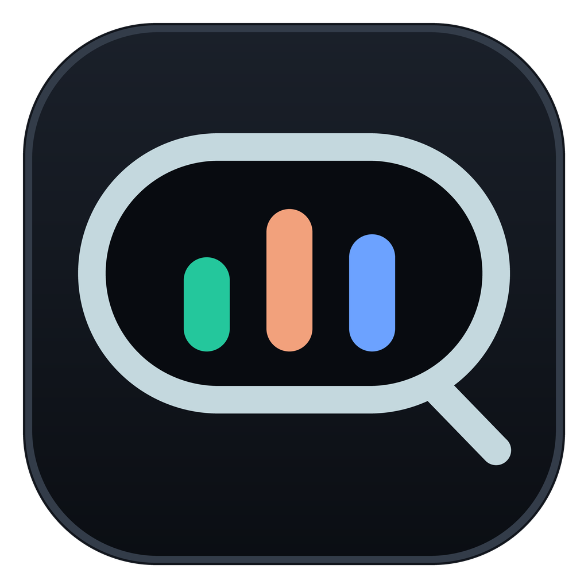</p>
<h1 align="center">QuotaMonitor</h1>
<p align="center"><strong>一款轻量的 Windows 灵动岛，实时查看 AI 编程工具的额度与 Token 用量。</strong></p>
<p align="center">Codex · DSH（DeepSeek Harness）· Antigravity · OpenCode Go</p>

<p align="center">
  <a href="https://github.com/asdstrind/QuotaMonitor/releases/latest"><strong>下载 v1.7.0（Windows 11 x64）</strong></a><br>
  <sub><code>QuotaMonitor-v1.7.0-win-x64.zip</code> · 自带运行时，无需安装器，无需管理员权限</sub>
</p>

<p align="center">
  
  
  
</p>

<p align="center"><a href="docs/media/v1.7.0/hero.png">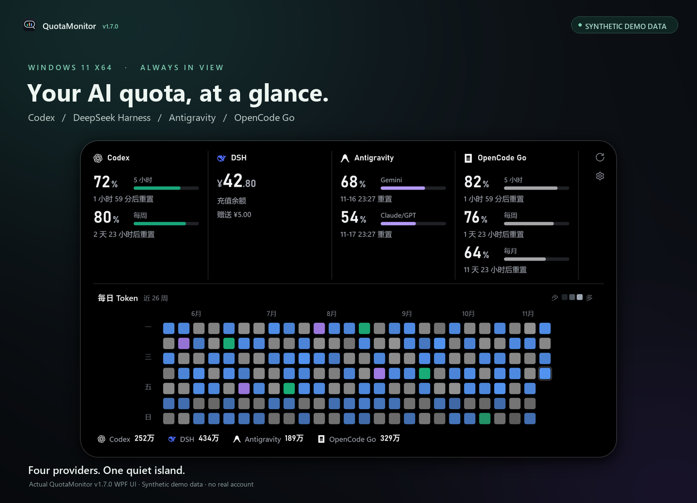</a></p>
<p align="center"><sub>QuotaMonitor v1.7.0 真实界面渲染，使用合成演示数据，不包含任何真实账户。</sub></p>

<p align="center"><code>额度窗口与重置时间</code> · <code>26 周 Token 热力图</code> · <code>本地优先的历史</code> · <code>低额度提醒</code> · <code>置顶灵动岛</code></p>

QuotaMonitor 安静地停在 Windows 桌面顶部，把你的 AI 编程工具最关心的数字收进一枚小小的岛里：剩余额度、重置倒计时、账户余额，以及用本机已有记录拼出的 Token 用量日历。

它直接复用你已经登录的工具——Codex CLI、DSH（DeepSeek Harness）和 Antigravity 客户端——OpenCode Go 则通过一个只读的 Console API Key 接入。不需要注册账户，没有埋点，也没有云端中转。

**目录：** [预览](#预览) · [功能](#功能) · [支持的平台](#支持的平台) · [额度监控](#额度监控) · [Token 用量分析](#token-用量分析) · [灵动岛](#灵动岛) · [安装](#安装) · [配置](#配置) · [安全与隐私](#安全与隐私) · [技术架构](#技术架构) · [从源码构建](#从源码构建) · [已知限制](#已知限制) · [许可证与致谢](#许可证与致谢) · [常见问题](#常见问题)

## 预览

<p align="center">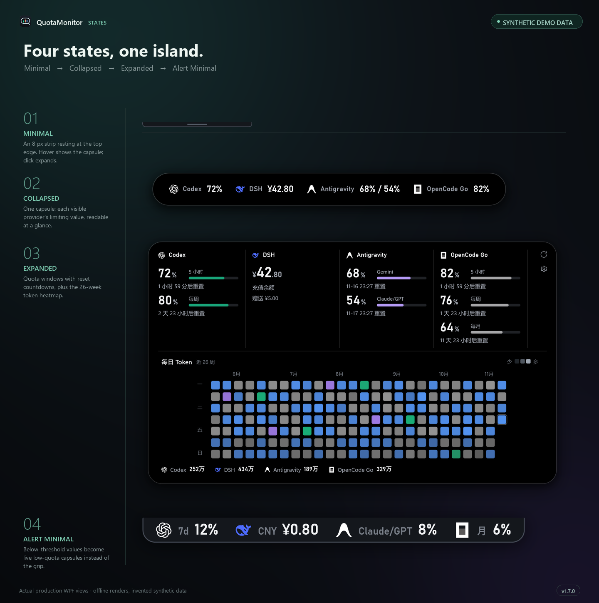</p>
<p align="center"><sub>极简 → 收起 → 展开 → 提醒极简。v1.7.0 真实界面，合成演示数据。</sub></p>

灵动岛状态、额度视图与 Token 热力图的生产界面截图，全部使用合成演示数据。

## 功能

- **四个平台，一枚灵动岛。** Codex、DSH、Antigravity 与 OpenCode Go 并排显示，也可以在设置里只保留你需要的平台。
- **服务端额度，不靠猜。** 剩余百分比与重置时间来自各服务自身的返回，展开态可查看每个窗口的细节。
- **本地优先的 Token 历史。** 26 周日历热力图、逐日 Tooltip 和各平台累计，来源是本机记录或服务端导出。
- **真正的桌面常驻。** 始终置顶、不占任务栏、全屏时自动隐藏，并随时能从通知区域找回。
- **克制而准确的低额度提醒。** 每个平台、每个窗口可独立设阈值；只有数据足够新鲜且确实偏低时，极简条才会展开成提醒胶囊。
- **形变结束再显示 Tooltip。** 日期 Tooltip 会等待灵动岛形变结束后再出现，展开过程中不再出现被裁切的瞬帧。
- **对缺失数据保持诚实。** 过期、部分或不可用状态会如实标注，绝不编造成 `0%`。
- **原生且轻量。** 基于 .NET 10 的 WPF 单目录自带运行时，没有 Electron、没有埋点、没有更新服务。

## 支持的平台

| 平台 | 看到什么 | 数据来源 | 需要什么 |
| --- | --- | --- | --- |
| **Codex** | 服务端返回的额度窗口（5 小时 + 每周）与重置倒计时 | 复用 Codex CLI 登录，通过 app-server 的 `account/rateLimits/read` 读取 | 安装并登录 Codex CLI；`codex.exe` 自动发现，也可手动指定路径 |
| **DSH**（DeepSeek Harness） | 官方 DeepSeek 钱包余额（充值 + 赠送，保留原始币种）与 DeepSeek 路由的 Token 用量 | 余额由 [DSH Balance Bridge](bridge/dsh-balance-bridge/README.md) 在官方 DSH 宿主内转发；用量读取本机 DSH Session | 安装兼容的 DSH Desktop、完成登录并安装 Balance Bridge 1.3.0 |
| **Antigravity** | 两个 **每周** 额度池：Gemini、Claude/GPT，含重置时间 | 官方 Antigravity 客户端登录并运行时，读取其本地 Language Server | 打开并登录官方 Antigravity 客户端 |
| **OpenCode Go** | 滚动 5 小时、每周、每月三个额度窗口；Token 导出历史 | OpenCode 额度接口与 Console 用量导出（`provider=opencode-go`，90 天） | 在设置中保存 OpenCode Console **只读** API Key |

> **DSH 的 DeepSeek 余额与 OpenCode Go 订阅是两个相互独立的计费来源。** QuotaMonitor 分开展示，不会合并、换算，也不会用其中一个推断另一个。Antigravity 的 Claude/GPT 池是 Antigravity 自己的每周额度，不是 Claude 订阅，也不是 Anthropic 账单。

> **v1.7.0 只监控四个平台。** 旧版中的 ClaudeCN 集成已移除；Antigravity 的 Gemini 与 Claude/GPT 两个每周额度池仍然完整保留。

<p align="center">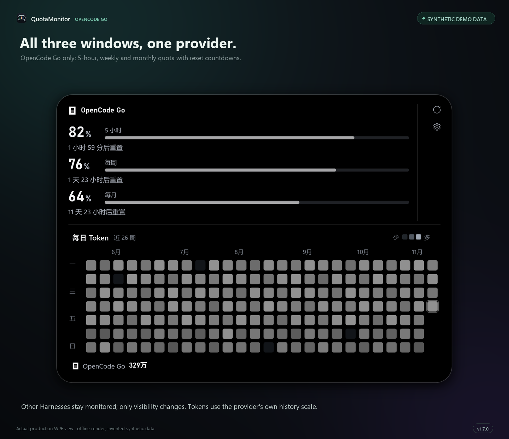</p>
<p align="center"><sub>单独查看 OpenCode Go：三个服务端窗口与各自的剩余百分比、重置时间。合成演示数据。</sub></p>

## 额度监控

展开态为每个可见平台显示一块紧凑的仪表：额度剩余百分比、重置倒计时和进度条，或钱包余额及其赠金钱包。

- **Codex** 由服务端给出额度窗口，窗口时长与重置时间都来自响应；并非每个账户都有 5 小时和每周两个窗口，界面只呈现实际返回的内容。收起态下，若所选额度池中确有未重置的耗尽窗口，会显示 `0%`。
- **DSH** 展示 Balance Bridge 送来的官方账户快照：充值钱包与赠送钱包按原始币种分别显示，不做跨币种求和或换算。Bridge 在官方宿主内每三分钟查询一次；超过四分钟未更新会标记为过期。
- **Antigravity** 提供两个独立的每周额度池（Gemini、Claude/GPT），**不是** 两周周期；读不到时显示不可用或过期，不会推算剩余额度。
- **OpenCode Go** 返回三个服务端窗口：滚动 5 小时、每周、每月，剩余百分比为 `100 − 已用`。收起胶囊按官方额度比例（5 小时 = 月基数的 20%，每周 = 50%，每月 = 100%）选出最受限的窗口，并显示该窗口自身的百分比。

读取失败时保留最近一次有效值并标记**过期**；从未读到过的平台显示**不可用**或配置提示。任何数字都不会被编造成零。

<p align="center">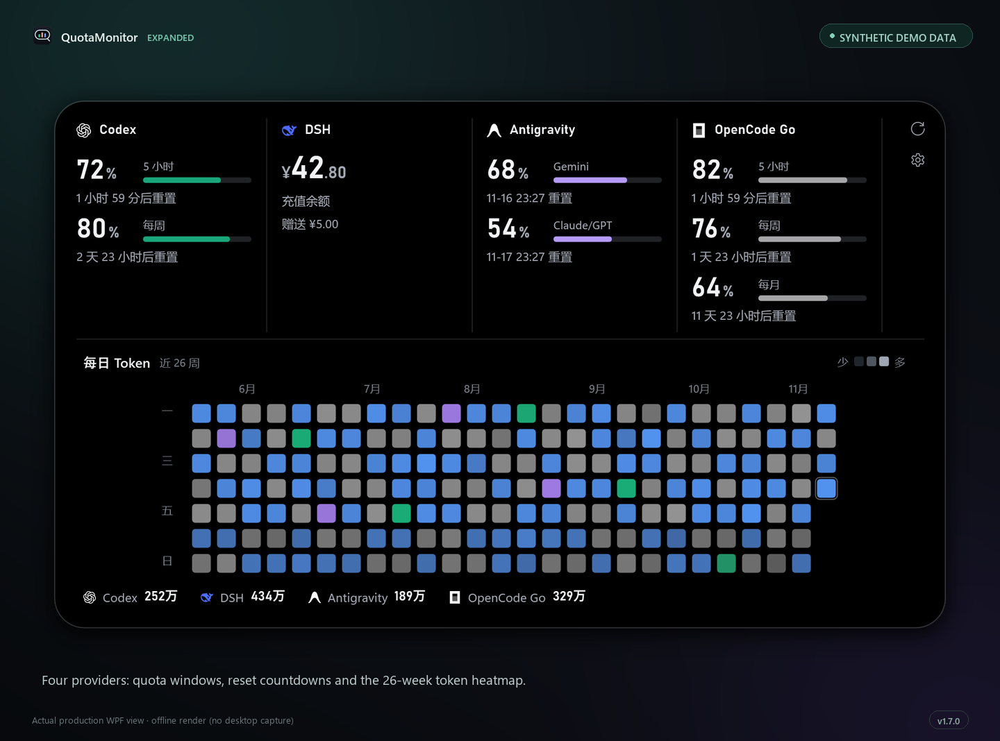</p>
<p align="center"><sub>展开态：每个平台一块仪表，显示窗口、余额与重置时间。合成演示数据。</sub></p>

<p align="center">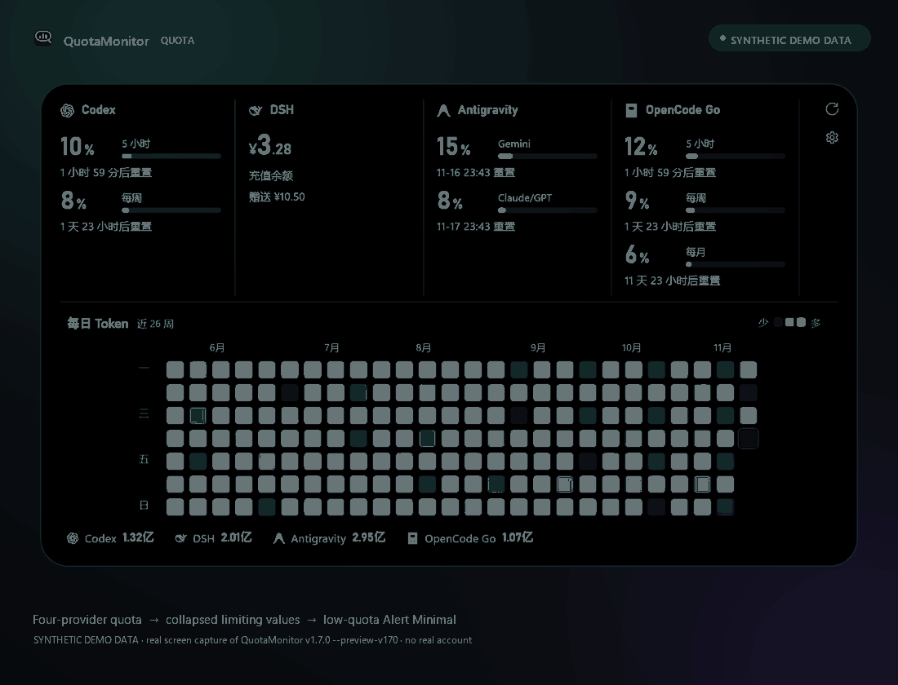</p>
<p align="center"><sub>额度仪表、收起态受限单值与低额度提醒行为。合成演示数据。</sub></p>

## Token 用量分析

Token 历史与额度刻意分开：它由 Codex、DSH、Antigravity 的本机只读记录，加上 OpenCode Go 自己的服务端导出汇总而成，绝不反过来推算额度。

- **Codex**：读取本机 `sessions` 与 `archived_sessions` 下的 rollout 文件，只解析数值型用量字段并丢弃对话正文；同一请求的明文与压缩副本按响应 ID 去重。
- **DSH**：读取本机已记录的 DeepSeek 路由会话。只统计有记录的真实请求，不补全未记录的辅助调用，也不代表账户终身用量。可选费用使用固定日期的价格快照估算，始终标记为 *Estimated*，不是账单。
- **Antigravity**：独立的只读本地历史通道（SQLite，可选 Tokscale 会话缓存），不读取聊天内容，也不把每周额度的变化换算成 Token。
- **OpenCode Go**：OpenCode Console 的 90 天 CSV 导出，仅筛选 `provider=opencode-go`。Token 为 `普通输入 + 输出 + 缓存读取 + 5 分钟缓存写入 + 1 小时缓存写入`，其中输出已包含 reasoning；日期保留服务端 UTC 日，因此标注 UTC，导出范围也不是终身历史。

热力图覆盖最近 26 周，以周一为一周起点，每天一个圆角方格：亮度使用共用对数刻度（按每日总量的 95 分位截断），颜色对应当天用量最多的平台。悬停某一天可查看各平台分项与合计；悬停图例中的平台可单独聚焦该平台的色带。图例累计展示的是当前已保存、可核实的历史——**不是**账户终身总量，未知值保持 `—`。

Codex、DSH 与 Antigravity 的每日汇总保存在本机；OpenCode Go 的历史只在内存中，重启后重新获取。计数口径与边界详见 [OPENCODE-GO-TOKENS.md](docs/OPENCODE-GO-TOKENS.md) 与 [ANTIGRAVITY-HISTORY.md](docs/ANTIGRAVITY-HISTORY.md)。

<p align="center">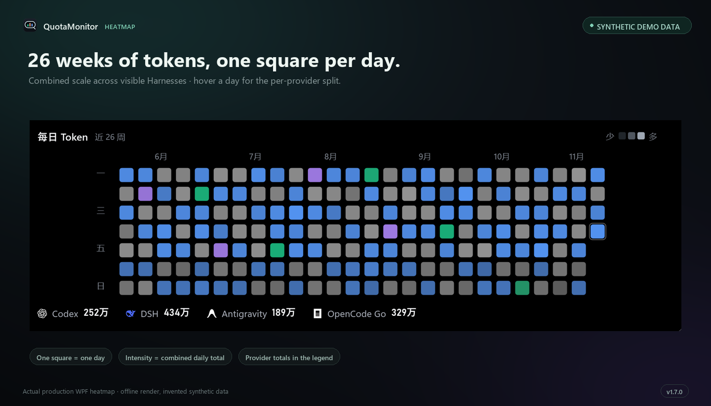</p>
<p align="center"><sub>26 周 Token 日历与各平台累计。合成演示数据。</sub></p>

<p align="center">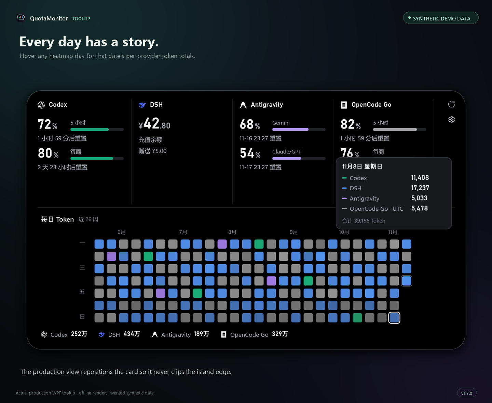</p>
<p align="center"><sub>逐日 Tooltip：各平台数值、合计，OpenCode Go 标注 UTC。合成演示数据。</sub></p>

<p align="center">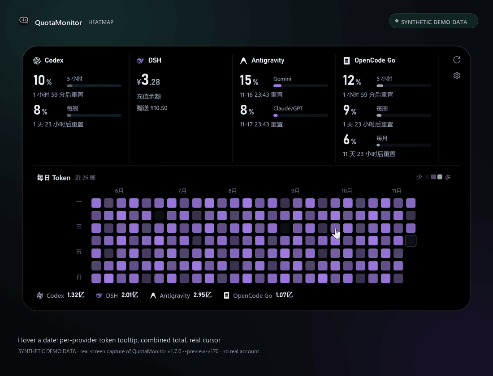</p>
<p align="center"><sub>热力图上的悬停、Tooltip 与平台聚焦。合成演示数据。</sub></p>

## 灵动岛

灵动岛有四种状态，由指针驱动，不会一直占用窗口：

| 状态 | 显示内容 |
| --- | --- |
| **极简** | 屏幕顶部一条细条，中间是一道安静的握把，不代表额度状态——靠近即可唤出胶囊。 |
| **收起** | 一枚胶囊，显示每个可见平台的核心数值：Codex 百分比、DSH 钱包余额、Antigravity 的 Gemini / Claude-GPT 百分比、OpenCode Go 的受限窗口。 |
| **展开** | 完整仪表盘：带重置倒计时的额度仪表与 Token 热力图，全程无滚动条。 |
| **提醒极简** | 数据足够新鲜且触发阈值时，极简条变为小胶囊，每个受影响平台一个「图标 + 数值」槽位。 |

- **悬停**靠近细条会显示**收起**胶囊；**点击**胶囊打开**展开**仪表盘；离开后自动回到**极简**（约 0.7–0.9 秒）；按 **Esc** 立即收起。
- **拖动**收起胶囊或展开态的仪表条即可移动位置。开启**顶部居中**（默认）时位置锁定在顶部正中，拖动会被忽略，直到你关闭该选项。自由位置会跨重启保存；关闭再开启顶部居中，仍会恢复此前保存的位置。
- **设置**可从展开态的齿轮图标、托盘菜单，或未选择平台时出现的齿轮按钮进入。
- **托盘**右键提供刷新、设置与退出。关闭灵动岛只会隐藏到通知区域；升级前请从托盘选择退出。双击托盘图标可唤回收起胶囊。
- 全屏应用会自动隐藏灵动岛（默认开启）；布局会缩放到可用工作区，而不是产生滚动条。

<p align="center">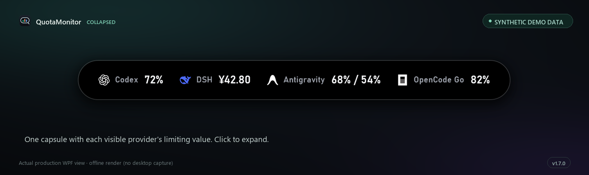</p>
<p align="center"><sub>收起态胶囊。合成演示数据。</sub></p>

<p align="center">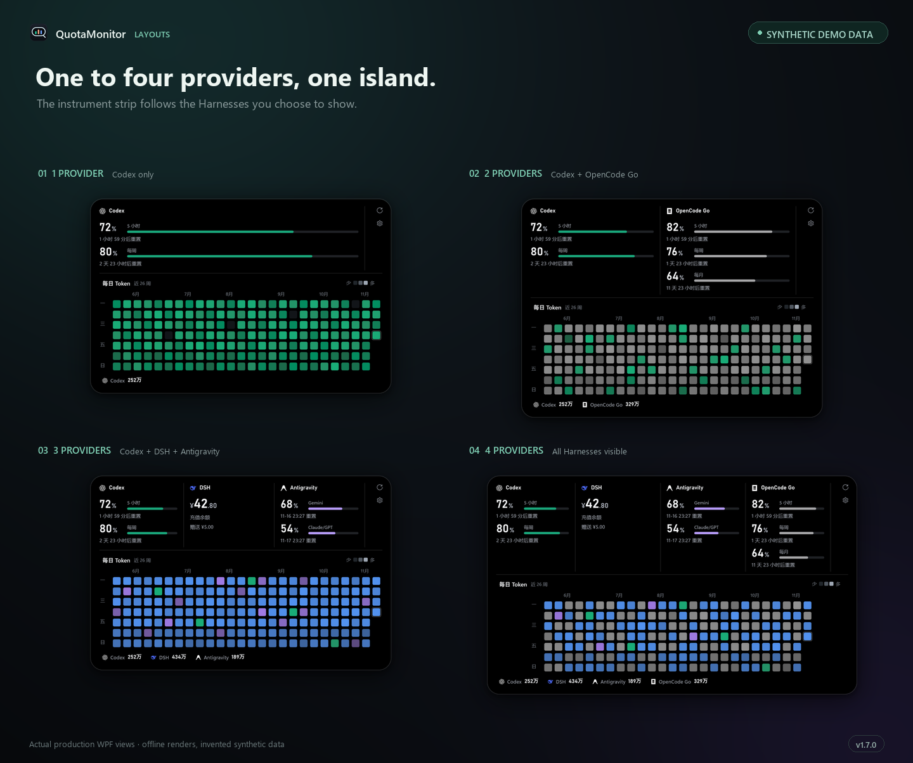</p>
<p align="center"><sub>可见平台从 1 个到 4 个，布局自适应。合成演示数据。</sub></p>

<p align="center">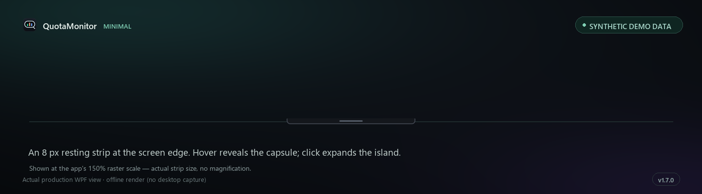</p>
<p align="center"><sub>极简细条。合成演示数据。</sub></p>

<p align="center">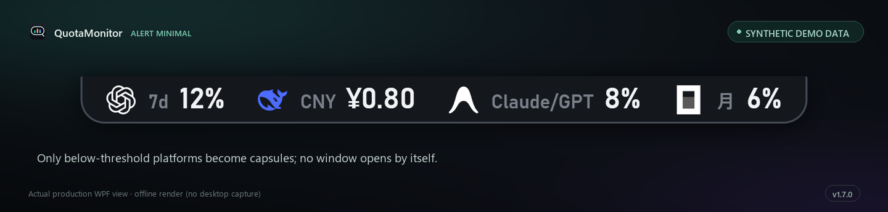</p>
<p align="center"><sub>提醒极简：每个受影响平台一个「图标 + 数值」槽位，只在数据新鲜且低于阈值时出现。合成演示数据。</sub></p>

## 安装

QuotaMonitor 以自带运行时的 Windows x64 ZIP 分发：.NET 运行时已包含在内，无需预先安装任何组件，也不需要管理员权限。

1. 从 [Releases](https://github.com/asdstrind/QuotaMonitor/releases/latest) 下载 `QuotaMonitor-v1.7.0-win-x64.zip`。
2. 解压**完整目录**并保持文件在一起，不要压缩包内直接运行。
3. 运行 `QuotaMonitor.exe`，灵动岛会出现在主显示器顶部中央。
4. 打开设置（展开态齿轮图标，或托盘 → 设置），连接你使用的平台。尚未配置或读不到数据的平台会显示配置提示，而不是编造的数字。

**Windows SmartScreen：** 可执行文件未做代码签名，首次启动可能出现「Windows 已保护你的电脑」。选择**更多信息 → 仍要运行**即可。Release 资产包含 `QuotaMonitor-v1.7.0-win-x64.zip` 与 `QuotaMonitor-v1.7.0-win-x64.zip.sha256`，运行前请先核对哈希。

**升级：** 先右键托盘图标选择**退出**，再替换目录；保留旧目录作为备份没有问题——设置并不在目录内。**卸载：** 从托盘退出，先在设置里关闭开机启动，删除目录，从 Windows 凭据管理器移除 `QuotaMonitor/OpenCodeGo/ConsoleReadOnlyApiKey`，如需清除本地历史再删除 `%LOCALAPPDATA%\QuotaMonitor`。

**系统要求：** Windows 11 x64。应用使用系统默认网络配置。

## 配置

设置分四页，可从展开态齿轮图标或托盘菜单打开；**Esc** 关闭，**Ctrl+S** 保存。

| 页面 | 可配置内容 |
| --- | --- |
| **常规 / General** | 显示哪些平台；顶部居中；全屏时隐藏；开机启动 |
| **平台 / Providers** | 每个平台的启用开关；OpenCode Go 只读 API Key（含测试连接、移除已存 Token）；DSH 与 Antigravity 的连接说明 |
| **提醒 / Alerts** | 各平台、各窗口的低额度阈值；填 `0` 关闭对应提醒；DSH 提醒币种（CNY / USD） |
| **高级 / Advanced** | 各平台刷新间隔（秒）；`codex.exe` 与 DSH Session 目录的路径覆盖；DSH 费用估算开关及可选的模型/价格覆盖 |

- **刷新**按平台独立进行：默认 Codex 180 秒、DSH 90 秒、Antigravity 60 秒、OpenCode Go 180 秒。间隔可设为 30–3600 秒（OpenCode Go 为 180–3600 秒）。手动刷新不会绕过 OpenCode Go 的额度/导出冷却，也不会忽略 `Retry-After`。
- **Codex 可执行文件**会从 `PATH` 自动发现；只有自定义安装才需要填路径。**DSH Session 目录**默认为当前用户的 `~/.dsh/sessions`，路径覆盖留空即保持自动发现。
- **OpenCode Go** 需要 Console 的**只读** API Key。保存时才会写入 Windows 凭据管理器，目标名为 `QuotaMonitor/OpenCodeGo/ConsoleReadOnlyApiKey`；输入框留空表示保留已存 Key。「测试连接」会同时校验额度接口与 Token 导出。
- **开机启动**只写入 QuotaMonitor 自己的当前用户 Run 值，保存时核对真实可执行文件路径；目录移动后首次手动运行会修复旧路径。它会尊重被禁用的启动项（例如在任务管理器中禁用），失败会直接显示在设置里，而不是假装成功。
- **DSH 费用估算**可以关闭。开启时使用固定日期的官方价格快照；未匹配的模型或未知的缓存写入价格保持未知，估算结果永远不会被标成账单。

<p align="center">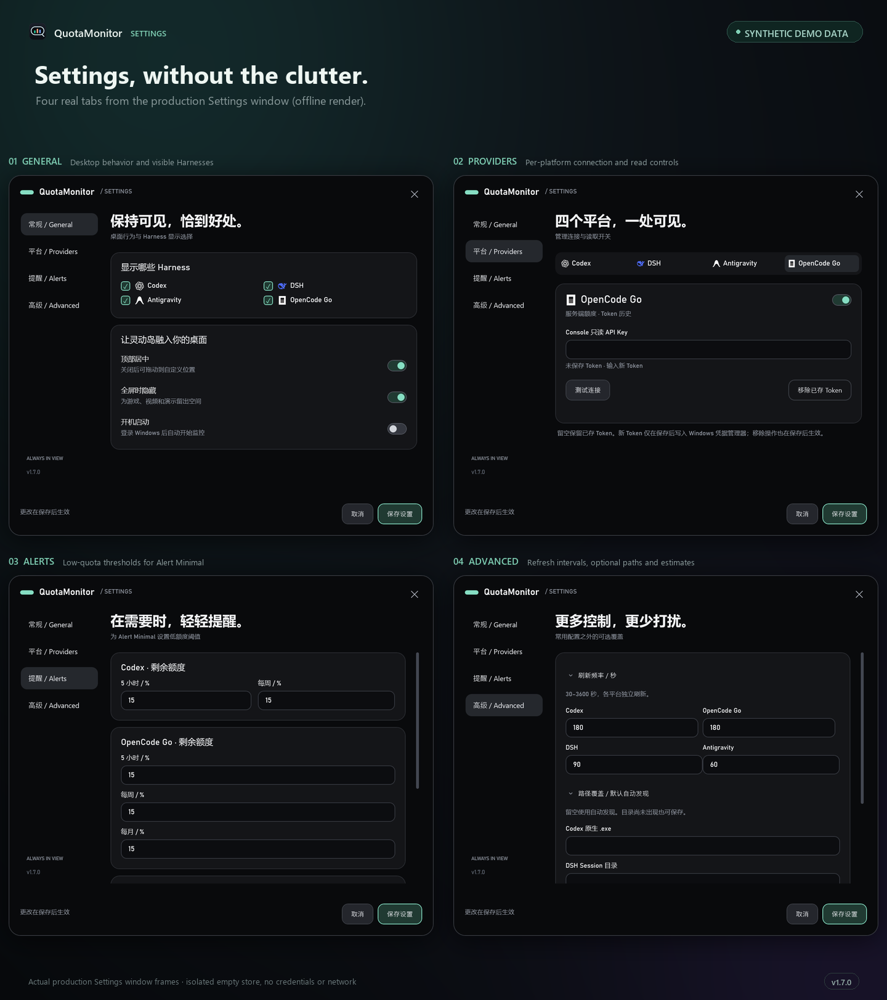</p>
<p align="center"><sub>v1.7.0 设置页（图中英文为展示标签）。</sub></p>

## 安全与隐私

- **只有一个密钥。** QuotaMonitor 唯一的密钥是你的 OpenCode Go 只读 API Key，保存在 Windows 凭据管理器 `QuotaMonitor/OpenCodeGo/ConsoleReadOnlyApiKey`；应用不内置任何账户或密钥。
- **无账户、无埋点。** 没有 QuotaMonitor 账户、没有统计分析、没有崩溃上传、没有云端中转。网络请求只发往源码固定的服务来源（Codex、DSH、Antigravity 使用本地进程或回环服务）。
- **本地数据。** 设置、余额快照与每日 Token 汇总保存在 `%LOCALAPPDATA%\QuotaMonitor`。它们不含 Token，但可能包含 User ID、私人路径、余额与用量，属于个人数据；截图或日志分享前请脱敏。
- **只读设计。** Codex 额度通过短生命周期 app-server 复用你自己的 CLI 登录，读取期间只对既有配置文件持有短时只读共享句柄，不读取凭证字节。DSH Balance Bridge 复用官方宿主的账户服务，不读取 Token、Cookie 或登录文件。Antigravity 只连接本地 Language Server 与只读 SQLite。Token 历史解析会丢弃聊天与工具正文。
- **公开素材。** 本 README 中的每张截图与每段动画都来自生产界面的合成演示数据，仓库不包含任何真实账户、Key、余额或历史。

完整边界见 [SECURITY.md](SECURITY.md)。报告安全问题请勿附带密钥：位置、类别、影响与脱敏复现步骤即可。

## 技术架构

QuotaMonitor 是单目录、自包含的 .NET 10 原生 WPF 应用（`net10.0-windows`，win-x64）。

- `src/QuotaMonitor` —— WPF 外壳、视图、视图模型、设置与凭据访问。
- `src/QuotaMonitor.Core` —— 平台 Adapter（Codex、DSH、Antigravity、OpenCode Go）、额度/余额模型、刷新协调器、历史协调器与热力图投影。
- `bridge/dsh-balance-bridge` —— 可选的 JavaScript 插件，让 DSH 通过仅当前用户可访问的命名管道送出官方余额快照。
- `tests/QuotaMonitor.Tests` —— 覆盖 Adapter、协议、历史计数、提醒与设置的 xUnit 测试。

实时值与历史由两个独立协调器刷新：历史回填再慢也不会拖慢灵动岛，历史失败也不会影响额度显示。界面直接使用 WPF 绘制，没有 Electron、WebView、内置数据库引擎、埋点 SDK 或更新服务。唯一的产品 NuGet 依赖是 `ZstdSharp.Port 0.8.8`（用于解压 DSH Session 帧）。第三方组件与许可证见 [THIRD_PARTY_NOTICES.md](THIRD_PARTY_NOTICES.md)；Bridge 的兼容范围与协议细节见 [bridge/dsh-balance-bridge/README.md](bridge/dsh-balance-bridge/README.md)。

更多细节：[ARCHITECTURE.md](ARCHITECTURE.md)。

## 从源码构建

需要 `global.json` 指定的 .NET SDK（10.0.401）及 Windows Desktop 组件；Node.js 24 仅用于可选的 DSH Bridge 测试。

```powershell
dotnet build QuotaEstimation.sln -c Release
dotnet test tests/QuotaMonitor.Tests/QuotaMonitor.Tests.csproj -c Release
dotnet publish src/QuotaMonitor/QuotaMonitor.csproj -c Release -r win-x64 --self-contained true -o publish/local-win-x64
```

`build.ps1` 封装了上述步骤，并优先使用本地 `.dotnet` SDK。发布打包脚本 `tools/package-release.ps1` 会生成带版本号的 ZIP、SHA-256 校验文件、Bridge 源码与完整许可证目录。完整说明、Bridge 测试与验证边界见 [BUILDING.md](BUILDING.md)。

## 已知限制

- **仅支持 Windows 11 x64。** 构建目标为 `net10.0-windows` win-x64，没有 ARM64、macOS 或 Linux 版本。
- **以单显示器为主。** 灵动岛围绕主显示器设计；混合 DPI 的多显示器、显示器热插拔与独占全屏游戏尚未做端到端验证。
- **服务接口可能变化。** 额度与余额来自私有或未公开的机制（Codex app-server、DSH 宿主插件、Antigravity 本地服务、OpenCode 接口）。上游一旦变化，界面会显示不可用或过期，而不是编造数字。
- **历史有边界，不等于终身。** 本地历史仅覆盖 Codex、DSH 或 Antigravity 实际记录的部分，OpenCode Go 则只有 Console 的 90 天导出；缺口保持未知。
- **部分平台需要本地组件在线。** Antigravity 需要官方客户端运行并登录，DSH 官方余额需要 Balance Bridge，OpenCode Go 需要只读 API Key。
- **界面语言。** 应用文案目前以中文为主，设置导航为中英双语（常规 / 平台 / 提醒 / 高级）；公开宣传图中的英文仅为展示标签。
- **Codex CLI 文件的短暂共享。** 读取 Codex 额度时，对既有 CLI 配置文件的短时只读共享可能延迟 CLI 并发写入；读取结束后立即释放。
- **独立项目。** 与 OpenAI、DeepSeek、Google、OpenCode 均无官方赞助、背书或隶属关系；详见 [TRADEMARKS.md](TRADEMARKS.md)。

## 许可证与致谢

QuotaMonitor 以 [MIT 许可证](LICENSE)发布。原创源码与原创美术资源适用 MIT；**第三方名称、Logo 与品牌素材不在该授权范围内**，权利归各自持有人所有——见 [TRADEMARKS.md](TRADEMARKS.md)。第三方组件（.NET 运行时、WPF/WinForms、`ZstdSharp.Port` 以及构建/测试包）遵循各自条款，保留的许可证文本见 [THIRD_PARTY_NOTICES.md](THIRD_PARTY_NOTICES.md) 与 [licenses](licenses) 目录。

QuotaMonitor 是 [asdstrind](https://github.com/asdstrind) 的独立个人项目，开发过程中得到 OpenAI GPT/Codex 与 Anthropic Claude 的 AI 协助——它们仅作为协助工具致谢，并非维护者。见 [CREDITS.md](CREDITS.md)。

## 常见问题

<details>
<summary><strong>需要准备 API Key 吗？</strong></summary>

Codex、DSH 与 Antigravity 不需要：它们复用官方客户端的登录与本地服务。例外是 OpenCode Go——需要在设置中保存 OpenCode Console 的**只读** API Key。
</details>

<details>
<summary><strong>为什么某个平台显示 <code>—</code>、「过期」或「不可用」？</strong></summary>

灵动岛不会用编造的值填补空缺。`—` 表示当前没有可核实的数值；**过期**表示保留最近一次有效值、但已超过新鲜度窗口；**不可用**表示来源读不到（例如 Antigravity 未运行、DSH 没有 Bridge 连接、OpenCode Go 未填 Key）。
</details>

<details>
<summary><strong>数据保存在哪里？会上传吗？</strong></summary>

设置、快照与每日汇总保存在本机 `%LOCALAPPDATA%\QuotaMonitor`，OpenCode Go 的 Key 保存在 Windows 凭据管理器。QuotaMonitor 不会上传任何数据；请求由你的电脑直接发往应用所需的服务来源。
</details>

<details>
<summary><strong>可执行文件有代码签名吗？为什么会触发 SmartScreen？</strong></summary>

没有代码签名。首次运行时选择**更多信息 → 仍要运行**，并核对 Release 附带的 SHA-256 校验文件；也可以直接从源码自行构建。
</details>

<details>
<summary><strong>如何升级或卸载？</strong></summary>

升级：托盘 → 退出，然后用新版本替换目录。卸载：关闭开机启动，从托盘退出，删除目录，移除 Windows 凭据管理器中的 `QuotaMonitor/OpenCodeGo/ConsoleReadOnlyApiKey`，如需清除本地历史再删除 `%LOCALAPPDATA%\QuotaMonitor`。
</details>

<details>
<summary><strong>还支持 ClaudeCN 吗？</strong></summary>

不支持。ClaudeCN 已在 v1.7.0 中移除。Antigravity 的 Claude/GPT 每周额度池仍受监控，因为它属于 Antigravity 自己的额度。旧平台的设置与历史会原样保留，但不再展示，也不会映射到当前四个平台。
</details>

<details>
<summary><strong>DSH 余额和 OpenCode Go 订阅会合并计算吗？</strong></summary>

不会。它们是相互独立的计费来源，分开展示；QuotaMonitor 不做币种换算，也不会用其中一个推断另一个。
</details>

<details>
<summary><strong>热力图合计等于账户终身用量吗？</strong></summary>

不等于。图例累计是当前已保存、可核实的历史——Codex、DSH、Antigravity 来自本机记录，OpenCode Go 最多覆盖 Console 的 90 天导出。未知日期不会按零填充。
</details>

<details>
<summary><strong>支持 Windows 10、ARM64 或多显示器吗？</strong></summary>

支持的目标是 Windows 11 x64 的主显示器。Windows 10 与 ARM64 没有可用构建，混合 DPI 的多显示器行为也尚未完整验证。
</details>

<details>
<summary><strong>如何反馈 Bug 或安全问题？</strong></summary>

在 GitHub Issue 中说明版本、平台、预期与实际现象。请勿附带 API Key、Token、真实余额、Session 文件或包含隐私数据的截图——脱敏截图或模拟数据的复现即可。安全敏感问题请按 [SECURITY.md](SECURITY.md) 处理。
</details>

---

[配置](docs/CONFIGURATION.md) · [构建](BUILDING.md) · [Bridge](bridge/dsh-balance-bridge/README.md) · [隐私](SECURITY.md) · [MIT](LICENSE) · [第三方商标](TRADEMARKS.md) · [English](README.md)
